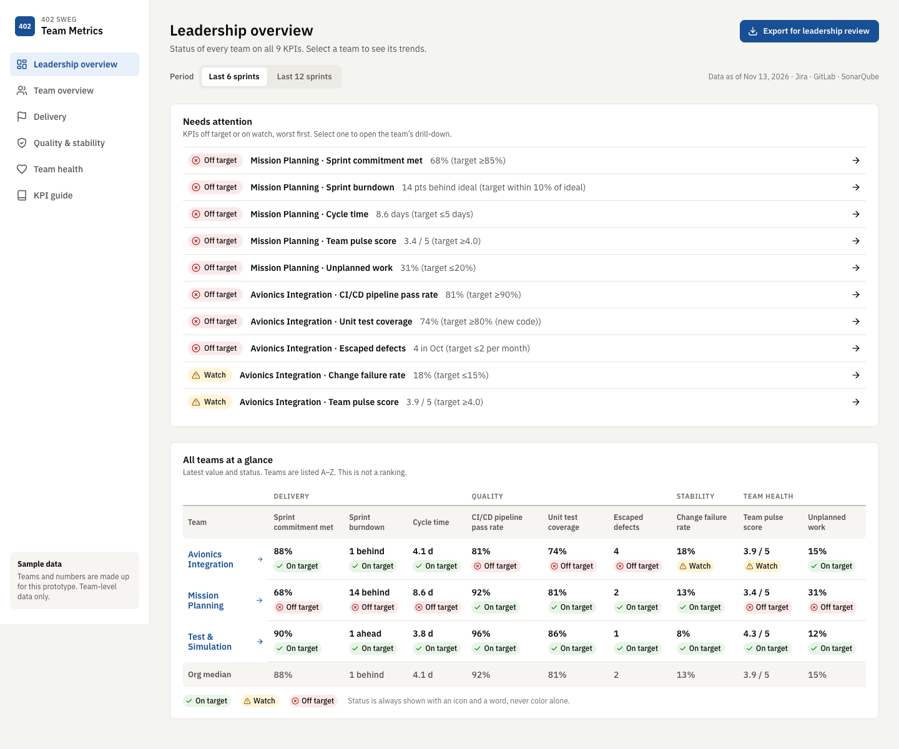
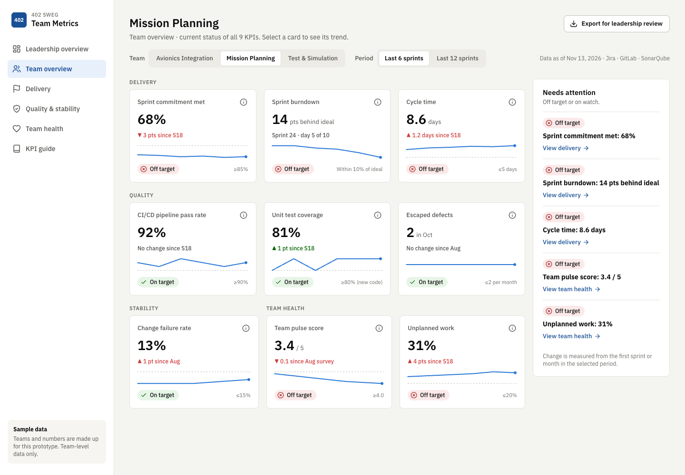

# UX-Final · 402 SWEG Team Metrics Dashboard

CBIS 4230 UX & Project Management final project (Fall 2026, GCSU). A team-level software metrics dashboard for the
402nd Software Engineering Group at Robins AFB. Team: Adam Lively, Harrison French, Jake Stine, Anna Nguyen.

> All team names and numbers in the prototype are **sample data**.

## Links
- **Figma (required prototype):** https://www.figma.com/design/BcuKePDNVmBjOnjeKcs81o
  (pages: Cover, Structure, Lo-fi wireframes, Design system, Hi-fi prototype; flow "Dashboard prototype")
- **Sprint 2 deliverable (Google Doc):** https://docs.google.com/document/d/1qN_LEZ2fBq-XbZC7g7mH0XwHcs8IKK6MIQWwCC9Ze6w/edit
- **Survey responses:** Developers form and Team Leaders/PMs form (Google Forms, owned by the instructor), summarized in `docs/survey-results.md`

## Run the coded prototype
```bash
cd app
npm install
npm run dev        # http://localhost:5173
```
`npm run build` makes a static site in `app/dist` (open `index.html` or deploy to GitHub Pages).

## What's in the app
| View | Answers |
|---|---|
| Leadership overview | Which team needs attention first? Status grid for all teams (A–Z), org median, export for the monthly report |
| Team overview | Is my team on track right now? 9 KPI cards in 4 groups + Needs attention |
| Delivery | Will we finish the sprint, and where is work stuck? |
| Quality & stability | Is quality getting better or worse? |
| Team health | Is the workload sustainable, and what pulls time away from planned work? |
| KPI guide | What does each number mean, and how could it be gamed? |

Every view has team tabs, a last 6 / 12 sprints toggle, ⓘ definitions on each KPI, hover tooltips and a table view on charts.

## Repo map
```
CLAUDE.md / AGENTS.md   context for Claude Code and Antigravity agents
app/                    React + TypeScript + Vite prototype
docs/                   project brief, survey results, KPI framework, design system, deliverables
.github/workflows/      optional GitHub Pages deploy
```

## Timeline
- Sun Nov 22 — Sprint 2 due: structure, annotated wireframes, design system, Figma prototype, test plan, backlog, peer eval
- Mon Nov 23 / Tue Nov 24 — Sprint 2 review with Dexter
- Thu Dec 3 — final report, testing report, refined prototype, slides, 15-minute presentation

## Screenshots


